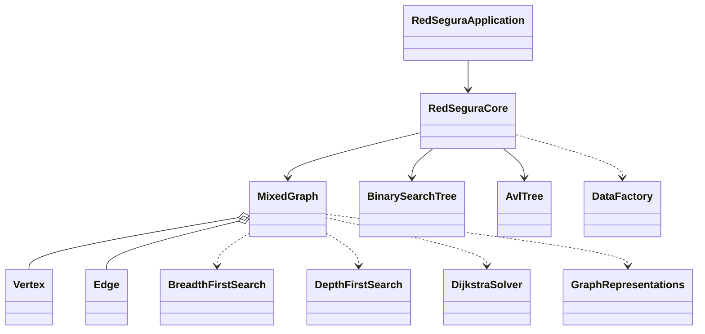

# RedSegura Sincelejo

Parcial 2 de **Estructura de Datos II**: árboles y grafos aplicados a una red de atención de emergencias.

El programa modela 12 lugares de Sincelejo y 18 conexiones con un **grafo mixto** (conexiones dirigidas y no dirigidas,
con etiqueta y peso en minutos). Los lugares también se guardan en un **ABB** y en un **AVL**. Todo está implementado a mano;
la única librería externa es JUnit 5 para las pruebas.

> Los tiempos son datos didácticos de simulación, no información oficial.

## Requisitos

- JDK 17 o superior
- Maven (Apache NetBeans ya lo trae)

## Cómo ejecutarlo

**En NetBeans:** `File > Open Project`, elegir la carpeta del proyecto y luego:
- `Run Project` (F6): abre el menú.
- `Test Project` (Alt+F6): corre las pruebas.

**En la terminal:**
```bash
mvn clean package
```
```bash
java -jar target/redsegura-1.0.0.jar
```
```bash
java -jar target/redsegura-1.0.0.jar --demo
```
El modo `--demo` ejecuta Q1 a Q7 seguidas y termina.

En el menú, cuando se pide un dato, basta con presionar Enter para usar el valor del enunciado (S02, S08, R16...).
Si se escribe un ID que no existe o un peso inválido, se muestra `[ERROR] ...` y el menú sigue funcionando.

| Opción | Qué hace |
|---|---|
| 1 | Q1: buscar un lugar en el ABB y en el AVL y comparar los pasos |
| 2 | Q2: rotaciones LL, RR, LR y RL con tres claves |
| 3 | Q3: lista de adyacencia, matriz de adyacencia y matriz de incidencia |
| 4 | Q4: BFS y DFS desde un vértice |
| 5 | Q5: ruta mínima con Dijkstra |
| 6 | Q6: bloquear una conexión y recalcular la ruta |
| 7 | Q7: consultar un vértice (si no existe, muestra un error y sigue) |
| 8 / 9 | Cambiar el peso de una conexión / desbloquear una conexión |
| 10 | Componentes débilmente conexas y ciclos |
| 11 | Medición de tiempos ABB vs AVL |
| 12 / 13 | Restaurar los datos originales / demo completa |

## Estructura

Todo está en el paquete `com.redsegura`:

| Clase | Responsabilidad |
|---|---|
| `Vertex`, `Edge` | Modelo: lugar y conexión (ID, etiqueta, peso, orientación y validaciones) |
| `MixedGraph` | Grafo mixto con lista de adyacencia; agrega, consulta, bloquea y cambia pesos |
| `GraphRepresentations` | Lista de adyacencia, matriz de adyacencia ponderada y matriz de incidencia |
| `BinarySearchTree` | ABB: insert, search, delete, inOrder, preOrder, postOrder, height |
| `AvlTree` | AVL: lo mismo que el ABB, más alturas, factor de balance y rotaciones |
| `BreadthFirstSearch` | BFS con cola, visitados y árbol BFS |
| `DepthFirstSearch` | DFS recursivo, detección de ciclos y componentes débiles |
| `DijkstraSolver` | Dijkstra con PriorityQueue, relajación y mapa de predecesores |
| `DataFactory` | Clase fábrica que crea los 12 lugares y las 18 conexiones |
| `RedSeguraCore` | Une el grafo y los árboles y responde las consultas |
| `RedSeguraApplication` | Menú de consola; solo habla con `RedSeguraCore` |

### Diagrama de dependencias



Todos los atributos son `private`. Las clases se comunican solo con métodos públicos, y las listas se devuelven como copias.

## Complejidad

V = vértices, E = conexiones, n = claves del árbol, h = altura del árbol.

| Operación | Tiempo | Espacio |
|---|---|---|
| ABB insert / search / delete | O(h): O(log n) si está balanceado, O(n) en el peor caso | O(h) por la recursión |
| AVL insert / search / delete | O(log n) siempre | O(log n) |
| Una rotación AVL | O(1) | O(1) |
| Recorridos in/pre/post orden | O(n) | O(h) |
| addVertex, addEdge, getVertex | O(1) | O(V + E) para todo el grafo |
| getNeighbors(v) | O(grado de v) | O(grado de v) |
| Lista de adyacencia | O(V + E) | O(V + E) |
| Matriz de adyacencia | O(V² + E) | O(V²) |
| Matriz de incidencia | O(V · E) | O(V · E) |
| BFS / DFS / componentes / ciclos | O(V + E) | O(V) |
| Dijkstra con PriorityQueue | O((V + E) log V) | O(V + E) |

## Resultados de control

| Consulta | Resultado |
|---|---|
| Q1 | Hospital Universitario: ABB en 3 pasos (altura 7), AVL en 1 paso (altura 4) |
| Q2 | LL (30,20,10), RR (10,20,30), LR (30,10,20) y RL (10,30,20); en los cuatro casos la raíz final es 20 |
| Q4 | BFS: S02 S01 S06 S07 S09 S05 S08 S10 S12 S03 S04 S11 |
|    | DFS: S02 S01 S07 S09 S05 S10 S08 S12 S03 S04 S11 S06 |
| Q5 | **S02 → S01 → S07 → S08 = 24 minutos** (R04, R01, R16) |
| Q6 | Con R16 bloqueada: S02 → S01 → S09 → S10 → S08 = 24 minutos (había otra ruta con el mismo costo) |
| Q7 | S99 muestra "El vértice S99 no existe en el grafo." y el programa continúa |

## Pruebas

`mvn test` ejecuta 36 pruebas JUnit 5 en 3 clases (`TreesTest`, `GraphTest`, `AlgorithmsTest`). Prueban casos normales,
vértices inexistentes, IDs duplicados, pesos inválidos (0 y negativos), grafos desconectados, orientación de los arcos,
bloqueos y las cuatro rotaciones AVL.

```
Tests run: 36, Failures: 0, Errors: 0, Skipped: 0
BUILD SUCCESS
```

Más detalle en [docs/INFORME.md](docs/INFORME.md).
